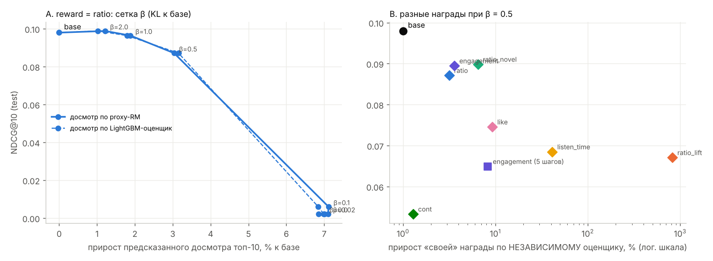
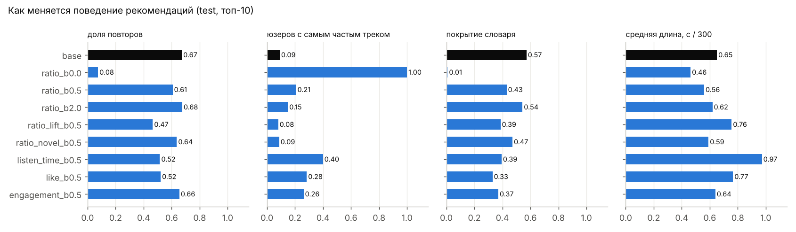
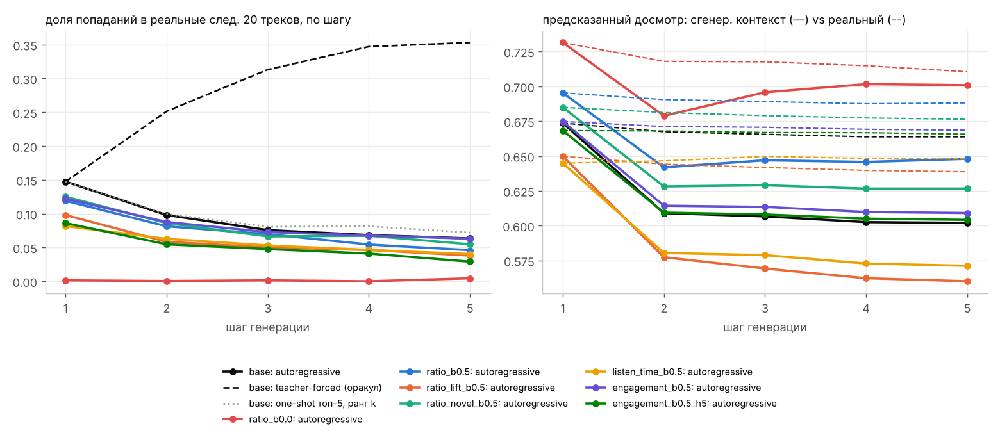
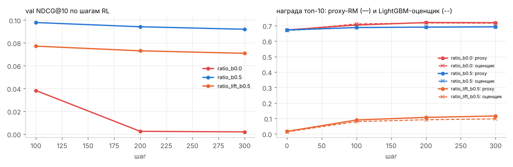

# RL-дообучение GPT-2 рекомендателя на Yambda: что происходит, когда оптимизируешь награду

**Коротко.** На Yambda-50M (Яндекс Музыка) я обучил GPT-2, который предсказывает следующий трек, построил reward model отклика
пользователя и дообучил рекомендатель с помощью RL (GRPO-подобный policy gradient с KL к исходной модели). Сравнил 7 функций
награды и 6 значений силы KL-поводка при одном протоколе оценки, а также проверил генерацию 5 треков подряд.

| Тест (дни 290–300, 8 196 юзеров) | NDCG@10 | предсказанный досмотр топ-10 (proxy / независимый оценщик) | у какой доли юзеров есть самый частый трек | средняя длина трека | KL к базе |
|---|---|---|---|---|---|
| базовая GPT-2 | 0.098 | 0.669 / 0.666 | 9% | 195 с | 0 |
| RL, награда «досмотр», β = 0 | **0.002** | **0.716 / 0.711** | **100%** | **139 с** | 12.5 |
| RL, «досмотр», β = 0.5 | 0.087 | 0.690 / 0.686 | 21% | 168 с | 0.51 |
| RL, «досмотр», β = 2 | **0.099** | **0.677 / 0.672** (+1.2%) | 15% | 186 с | 0.04 |
| RL, «досмотр нового» (штраф за повтор), β = 0.5 | 0.090 | 0.681 / 0.678 | **9%** | 177 с | 0.25 |
| RL, «время прослушивания», β = 0.5 | 0.069 | 0.653 / 0.636 | 40% | **292 с** | 0.69 |
| RL, «лайк», β = 0.5 | 0.075 | P(лайк) ×1.26 по proxy, ×1.09 по оценщику | 28% | 230 с | 0.88 |



**Главные выводы**

1. **Награду можно поднять, но лишь немного без потери релевантности.** При сильном KL (β = 2) предсказанный досмотр растёт на 1.2%,
   и независимый оценщик подтверждает рост (+1.0%), а NDCG не падает (0.098 → 0.099). Дальше начинается обмен: β = 0.5 даёт +3%
   награды за −11% NDCG.
2. **Без поводка модель «взламывает» награду за ~150 шагов.** Все 8 196 юзеров получают одни и те же ~10 коротких треков.
   Это не ошибка reward model: независимый LightGBM-оценщик тоже видит рост. Сломана сама **формулировка** награды: досмотр
   сильнее всего зависит от трека (короткий дослушают все), а не от того, подходит ли он конкретному юзеру.
3. **Каждая награда даёт свой предсказуемый перекос.** «Досмотр» → короткие треки. «Время прослушивания» → длинные (292 с).
   «Лайк» → длинные и популярные. «Продолжит слушать» → популярное. Моя «дебиасированная» награда (досмотр минус средний досмотр
   трека) дала **обратный** перекос: самые длинные «недослушиваемые» треки.
4. **Лучший баланс даёт досмотр со штрафом за повтор знакомого**: NDCG по *новым* трекам выше базы (0.0145 против 0.0135),
   концентрация не растёт (9%), энтропия политики выше, чем у базы.
5. **Разреженную награду (лайк) RL переоптимизирует:** по proxy-RM лайков становится на 26% больше, а по независимому оценщику —
   только на 9%. Расхождение двух оценщиков — практичный детектор взлома.
6. **Многошаговая генерация уводит модель от реальности.** Сгенерированный трек — не прослушанный, и попадания падают с 0.147 на 1-м
   шаге до 0.063 на 5-м. Заметная часть «эффекта» многошаговой награды — артефакт того, как мы симулируем отклик юзера на
   сгенерированный трек.

Важный контекст: в музыке **68% прослушиваний — повторы**. Эвристика «самые частые треки юзера» даёт NDCG 0.180 —
почти вдвое больше GPT-2. Так что «повторять знакомое» — это и релевантно, и потенциальный способ взлома награды.

---

## 1. Данные и разбиение

**Yambda-50M** (`flat/50m`: listens, likes, dislikes): 46.5M прослушиваний, 9 238 юзеров, 877k треков, 300 дней.
У каждого прослушивания есть `played_ratio_pct`, `track_length_seconds` и `is_organic`.

Чтобы уложиться в CPU (2 ядра, 8 ГБ), данные ужаты так:

- **период — дни 180–300** (~4 месяца);
- **словарь — топ-20k треков** по числу прослушиваний в train-периоде, без утечки. Они покрывают ~65% прослушиваний;
  остальные события удалены;
- итог: **14.7M прослушиваний, 9 158 юзеров**, ~1 600 событий на юзера (медиана 980);
- `played_ratio_pct` обрезан до 100 (0.5% значений > 100 — перемотка).

**Отклики для reward model:**

- доля прослушивания (досмотр). Распределение двугорбое: 25% прослушиваний — скип (< 7%), медиана — 100%;
- лайк в течение суток после прослушивания (1.0% прослушиваний);
- продолжение сессии: следующее прослушивание в течение 30 минут (92%).

**Временное разбиение (глобальное):**

| | события | использование |
|---|---|---|
| train | дни < 280 | обучение GPT-2, reward model, LightGBM-оценщика; контексты для RL |
| val | контекст — всё до дня 280; таргет — первые 20 прослушиваний в [280, 290) | выбор числа эпох, β, сравнение по ходу RL |
| test | контекст — всё до дня 290; таргет — первые 20 прослушиваний в [290, 300] | итоговая оценка |

Ни одна модель не видит событий ≥ 280 при обучении. Контекст теста (дни 280–290) — это прошлое на момент рекомендации,
поэтому его использование не является утечкой. `tests/test_leakage.py` проверяет: словарь построен только по train,
обучающие массивы строго до 280, контексты val/test — это ровно последние 64 события до границы, а таргеты — ровно следующие
20 событий.

## 2. Базовая модель: GPT-2, next-item prediction

- `transformers.GPT2LMHeadModel`: токен = id трека (0 = pad), 2 слоя, d = 128, 4 головы, контекст 64 трека, связанные
  эмбеддинги входа и выхода, 3M параметров.
- Обучение — CE на следующий трек по случайным окнам из train-последовательностей. Лосс считается на последних 16 позициях
  окна: голова на 20k классов — основная стоимость на CPU, а на инференсе у юзеров полный контекст. 4000 шагов × 128 окон,
  AdamW, косинус (2 этапа по 2000 шагов), ~60 мин.
- Рекомендация = top-K по логитам на последней позиции. Повторы **разрешены**: в музыке это нормальное поведение.

| test | NDCG@10 | Recall@10 | MAP@10 | Recall@50 | NDCG@10 по новым трекам | доля повторов в топ-10 | покрытие словаря |
|---|---|---|---|---|---|---|---|
| популярное | 0.027 | 0.025 | 0.013 | 0.046 | 0.008 | 43% | 0.05% |
| самые частые треки юзера (последние 64) | **0.180** | **0.166** | **0.124** | **0.232** | 0.000 | 99% | 85% |
| **GPT-2 (база для RL)** | 0.098 | 0.091 | 0.052 | 0.158 | **0.0135** | 67% | 57% |

GPT-2 недообучена: лосс ещё падал, а шагов было мало из-за CPU. Но она уже делает то, чего не умеет эвристика: находит новые треки.
Для RL важна не абсолютная точность базы, а то, как RL меняет её поведение при одинаковом протоколе.

## 3. Reward model

`src/reward.py`. Предсказывает отклик на трек-кандидат с учётом истории.

- **Энкодер истории** — GPT-2 (инициализирован из базовой модели, как RM из SFT-модели в RLHF). Вход: трек + **бакет досмотра**
  каждого события истории (RM, в отличие от политики, видит, что юзер скипал, а что дослушивал).
- **Кандидат**: эмбеддинг, log-популярность, длина, средний досмотр трека в train, сколько раз и как давно трек был в контексте
  (повтор).
- **3 головы**: досмотр (BCE с мягкой меткой ratio/100), P(лайк), P(продолжит слушать 30 мин). 1500 шагов × 256 примеров.
- **Независимый оценщик** — LightGBM на 10 ручных признаках: средний досмотр и доля скипов юзера, повтор, давность, популярность,
  длина и т.д. Это другой класс модели с другими ошибками. В RL он не участвует, а нужен, чтобы отличать реальный рост награды от
  эксплуатации ошибок proxy-RM.

Отложенная выборка: первые 20 событий каждого юзера после границы (val: 139k, test: 145k примеров), контекст — 64 события
строго до примера.

| test | MAE досмотра | Spearman | AUC скипа (< 10%) | AUC скипа, новые треки | AUC скипа, повторы | AUC лайка | AUC продолжения |
|---|---|---|---|---|---|---|---|
| глобальное среднее | 0.403 | — | 0.500 | 0.500 | 0.500 | — | — |
| средний досмотр трека | 0.389 | 0.15 | 0.587 | 0.596 | 0.564 | — | — |
| средний досмотр юзера (контекст) | 0.318 | 0.42 | 0.729 | 0.751 | 0.672 | — | — |
| **proxy-RM (GPT-2)** | **0.277** | **0.54** | **0.811** | **0.831** | **0.759** | 0.658 | **0.585** |
| LightGBM-оценщик | 0.283 | 0.53 | 0.798 | 0.812 | 0.760 | **0.670** | 0.574 |

- RM хорошо отличает скип от дослушивания: AUC 0.81, существенно лучше бейзлайнов.
- **Досмотр в основном определяется юзером** (бейзлайн «средний досмотр юзера» уже даёт 0.73), а трек влияет слабее (0.59).
  Поэтому в награде легко найти «универсальные» треки, которые дослушивают все.
- **Лайк** (1% положительных) и **продолжение сессии** (92% положительных) предсказываются слабо. Продолжение сессии почти
  не зависит от конкретного трека: это свойство сессии (юзер на тренировке будет слушать дальше что угодно). Как награда оно
  несёт мало персонального сигнала и **легко подменяется популярностью**, что и произошло в RL (§5.3).
- Proxy и оценщик согласованы на залогированных данных (Spearman 0.92). Это не гарантирует согласия на треках, которые
  выбирает RL-политика, и именно это проверяется дальше.

## 4. RL-дообучение

`src/rl.py`. Постановка: состояние — контекст юзера (64 трека), действие — трек, награда — функция предсказаний RM.

- **GRPO-подобный policy gradient**: на каждый из 64 контекстов сэмплируем G = 16 треков из π(·|s). Advantage — награда минус
  среднее по группе, делённое на std группы (группа заменяет value-функцию, как в GRPO для LLM).
  `loss = −mean(A · log π(a|s)) + β · KL(π(·|s) ‖ π_ref(·|s))`.
- **KL считается точно** по всему словарю (у нас есть все 20k логитов), а не оценкой по сэмплам. Это дешевле и стабильнее.
  π_ref — базовая GPT-2.
- Состояния RL берутся только из train-периода. Dropout выключен (как в RLHF): иначе KL и log π шумят. Adam, lr 5e-5,
  300 шагов, ~2 мин на запуск.
- **Многошаговый вариант**: траектория из 5 треков. Каждый следующий генерируется с уже дописанными в контекст предыдущими.
  «Отклик» на сгенерированный трек для RM — бакет предсказанного досмотра. Награда — сумма по шагам, advantage — по группе из
  8 траекторий.

**Награды** (все считаются по proxy-RM):

| имя | формула | идея |
|---|---|---|
| `ratio` | E[досмотр] | краткосрочная вовлечённость |
| `listen_time` | E[досмотр] × длина / 200 | суммарное время прослушивания |
| `like` | 10 · P(лайк) | явная удовлетворённость |
| `cont` | P(следующее прослушивание ≤ 30 мин) | прокси удержания |
| `ratio_novel` | E[досмотр] − 0.5 · [трек уже в истории] | досмотр без «халявы» за повторы |
| `ratio_lift` | E[досмотр] − средний досмотр трека | персональное попадание вместо «универсальных» треков |
| `engagement` | 0.4 · досмотр + 0.4 · cont + 2 · P(лайк) − 0.3 · [повтор] | комбинированный «долгосрочный» прокси |

Для каждой модели считаются одинаковые метрики на val и test:

- релевантность: NDCG / Recall / MAP@10, Recall@50, NDCG по новым трекам;
- поведение: доля повторов, покрытие словаря, доля юзеров с самым частым треком, Gini экспозиции, длина и популярность треков,
  энтропия политики, KL и Jaccard@10 с выдачей базы;
- награда топ-10 по proxy-RM и по независимому оценщику;
- реально залогированный досмотр рекомендованных треков, которые юзер потом послушал.

## 5. Результаты и ответы на вопросы задания

Все числа — test. Полные таблицы — `results/rl.json`.

### 5.1 Как меняется поведение? Удаётся ли максимизировать награду?



Награда максимизируется всегда: при β = 0 за 100–150 шагов. **Как** она максимизируется, определяется её формой:

| награда (β = 0.5) | Δ своей награды: proxy / оценщик | NDCG@10 | повторы | юзеров с топ-треком | длина | популярность (доля топ-100) |
|---|---|---|---|---|---|---|
| база | — | 0.098 | 67% | 9% | 195 с | 12% |
| ratio | +3.0% / +3.1% | 0.087 | 61% | 21% | **168 с** | 19% |
| ratio_novel | +6.3% / +6.5% | **0.090** | 64% | **9%** | 177 с | 16% |
| ratio_lift | ×8 / ×9 | 0.067 | **47%** | 8% | **227 с** | 9% |
| listen_time | +45% / +41% | 0.069 | 52% | **40%** | **292 с** | 20% |
| like | +26% / **+9%** | 0.075 | 52% | 28% | 230 с | 21% |
| cont | +2.2% / +1.3% | 0.053 | 53% | 33% | 179 с | **28%** |
| engagement | +4.1% / +3.6% | 0.090 | 66% | 26% | 192 с | **30%** |
| engagement, 5 шагов | +9.2% / +8.3% | 0.065 | 47% | 26% | 193 с | 15% |

Объяснения:

- **`ratio` → короткие треки.** Предсказанный досмотр — это в первую очередь свойство трека и юзера, а персональное соответствие
  вторично. Самый дешёвый способ поднять среднее — короткие треки, которые все дослушивают. Без KL модель схлопывается в ~10 таких
  треков для всех. KL ≈ 12.5 nats: политика почти детерминирована, энтропия 0.11 против 7.0 у базы.
- **`listen_time` → длинные треки**: противоположный и столь же нерелевантный перекос.
- **`ratio_lift` — попытка «вычесть» популярность трека — перевернула перекос.** Награда «досмотр минус средний досмотр трека»
  максимальна для треков с *низким* средним досмотром, то есть длинных. При этом сам предсказанный досмотр **упал**
  (0.669 → 0.650). Дебиасинг через вычитание бейзлайна создаёт новую поверхность для эксплуатации.
- **`cont` и `engagement` → популярное.** Продолжение сессии почти не зависит от трека, и единственный сигнал, который RM в нём
  выучила, — популярность. RL усиливает именно его.
- **`ratio_novel`** — штраф за повтор убирает самый простой путь «дай знакомое». Политика остаётся разнообразной
  (энтропия 7.57 > 7.02 у базы), а NDCG по новым трекам растёт (0.0145 против 0.0135).

### 5.2 Сохраняется ли релевантность? Не рекомендует ли модель всем одно и то же?

- При β ≤ 0.1 — нет: NDCG@10 падает с 0.098 до 0.002–0.006, у **99.9–100%** юзеров в топ-10 один и тот же трек, Gini
  экспозиции 0.999, Jaccard с базовой выдачей 0.002.
- При β = 0.5 концентрация растёт для всех наград, кроме `ratio_novel` и `ratio_lift`: доля юзеров с самым частым треком —
  от 9% до 40%, покрытие словаря падает с 57% до 21–47%.
- При β ≥ 1 релевантность сохраняется: β = 2 — NDCG 0.099, покрытие 54%, Jaccard с базой 0.64.
- Реальные данные: залогированный досмотр рекомендованных треков, которые юзер потом действительно послушал, почти не меняется
  (73% у базы, 72–75% у несхлопнувшихся RL-моделей). Офлайн нельзя утверждать, что RL-рекомендации реально дослушивали бы лучше: мы видим отклик
  только на то, что юзер выбрал сам или ему показала прежняя система.

### 5.3 Можно ли приблизиться к долгосрочным целям?

**Какие сигналы в данных подходят** (от более краткосрочных к долгосрочным):

| сигнал | что измеряет | проблема |
|---|---|---|
| досмотр / скип | понравился ли трек сейчас | зависит от длины трека и «удобства», легко взламывается |
| лайк, дизлайк | явная оценка | 1% событий, RM слабая (AUC 0.66), RL переоценивает (proxy +26% против оценщика +9%) |
| продолжение сессии ≤ 30 мин | удержание в моменте | 92% положительных; почти не зависит от трека → подменяется популярностью |
| органика после рекомендации (`is_organic`) | юзер сам ищет музыку того же артиста — интерес «разбужен» | нужна связка трек ↔ артист (в Yambda есть отдельно) |
| возврат на следующий день / число активных дней за неделю | настоящая долгосрочная цель | отложенный на дни, отклик слабо атрибутируется одной рекомендации; нужна value-функция или TD |
| разнообразие и новизна потребления | не «выгорает» ли юзер на повторах | нужна модель «усталости» |

Я попробовал комбинированную награду `engagement` (досмотр + продолжение + лайк − повтор). Она поднимает свою метрику на
+4% (оценщик +3.6%) с умеренной потерей NDCG (−9%), но смещает выдачу к популярному (доля топ-100 с 12% до 30%).

**Что можно проверить офлайн:**

- качество reward model на отложенных данных по времени (§3);
- согласие с независимым оценщиком (детектор взлома);
- поведенческие метрики выдачи (концентрация, повторы, длина);
- релевантность к реальному будущему;
- off-policy оценки (IPS / doubly robust по логам `is_organic = 0`, где известна «рекомендательная» часть трафика).

**Что можно проверить только онлайн:**

- реальный отклик на треки, которые прежняя система не показывала (RM экстраполирует);
- возвраты и удержание через дни и недели (петля обратной связи: рекомендации меняют будущие данные);
- реакцию на «новую» выдачу (новизна и усталость).

Нужен A/B с метриками удержания на горизонте 2–4 недели и guardrail-метриками: разнообразие, доля органики, жалобы и дизлайки.

### 5.4 Генерация нескольких шагов вперёд

`scripts/04_rollout.py`, 3 000 тестовых юзеров. Генерируем 5 треков подряд: каждый дописывается в контекст, а для RM ему
приписывается предсказанный бакет досмотра.



- **Попадания падают по шагам**: у базы 0.147 → 0.098 → 0.076 → 0.068 → 0.063. Пошаговая генерация примерно эквивалентна
  топ-5 из одного прохода (на ранге 5 — 0.072; совпадение списков 58%). Генерировать по одному треку не выгоднее, чем взять
  топ-5 сразу.
- **Оракул (teacher forcing)** — дописывать *реальные* следующие треки юзера — поднимает попадания до 0.35. Осторожно: часть
  прироста тавтологична, потому что модель копирует только что дописанные треки, а они лежат в таргете. Но масштаб разрыва
  показывает, насколько сильно траектория зависит от того, что юзер **на самом деле** послушал.
- **Оценка награды на сгенерированном контексте смещена.** Предсказанный досмотр того же трека, посчитанный на сгенерированном
  контексте, на 2-м шаге падает 0.674 → 0.609, а на реальном контексте почти не меняется (0.667). Причина — симуляция отклика:
  мы приписываем сгенерированному треку *ожидаемый* досмотр (~0.65 → бакет «30–70%»), а реальные отклики двугорбые (скип или
  дослушал). RM видит «юзер слушает вполуха» — такого состояния почти нет в данных — и снижает прогноз. **Многошаговая награда
  измеряет не только качество рекомендаций, но и артефакты симулятора.**
- **Многошаговый RL** (`engagement`, 5 шагов) оптимизирует награду сильнее (+9% против +4% у одношагового), но сильнее уходит от
  базы (KL 1.13, NDCG 0.065, повторы 47%) и стоит в 7 раз дороже (16 мин против 2 мин). Без более реалистичного симулятора
  (сэмплировать отклик из распределения RM, а не брать среднее) и без регуляризации на реальные траектории это больше риск, чем выгода.
- Свёрнутая политика (`ratio`, β = 0) за 5 шагов для 3 000 юзеров использует всего **13** уникальных треков.

### 5.5 Компромисс «релевантность ↔ награда»

На рисунке вверху (панель A) видно:

- кривая β гладкая до β ≈ 0.5, затем обрывается: между β = 0.5 и β = 0.1 политика проваливается из «чуть смещённой» в «схлопнутую»,
  без промежуточных состояний;
- рабочая зона — β ∈ [1, 2]: +1.2…1.9% предсказанного досмотра при NDCG −1.6…+0.8%;
- с нормированным advantage (GRPO) масштаб β не зависит от масштаба награды. Поэтому β ≥ 1 — это естественный «поводок»
  относительно единичного advantage, а β = 0.02–0.1, привычные по RLHF, здесь слишком слабы.

На компромисс влияют:

1. **Форма награды** сильнее, чем β: при одинаковом β = 0.5 NDCG меняется от 0.053 (`cont`) до 0.090 (`ratio_novel`).
2. **Явный штраф за самый дешёвый путь** — повтор знакомого — улучшает компромисс.
3. **Разреженность сигнала** (лайк): proxy и оценщик расходятся — признак переоптимизации.
4. **Горизонт**: многошаговая оптимизация быстрее уводит от базы.



## 6. Ограничения

- **CPU-масштаб**: GPT-2 на 3M параметров, 20k треков, 4 месяца, 300 шагов RL, 1 сид на конфигурацию. База недообучена и
  уступает эвристике «любимые треки».
- **Награда целиком модельная.** Даже независимый оценщик учится на тех же логах с тем же смещением отбора (отклик есть только
  на выбранное юзером или прежней системой). Офлайн нельзя доказать, что RL-рекомендации лучше для реальных юзеров.
- Удалены события вне топ-20k треков. Повторы считаются только внутри окна дней 180–300.
- Лайк привязан к прослушиванию эвристически: в течение суток после него.

## 7. Что дальше

- Сэмплировать отклик в многошаговом симуляторе из распределения RM, а не брать среднее. Ансамбль RM со штрафом за неуверенность
  (pessimism) против эксплуатации.
- Нормировать досмотр на длину трека или предсказывать досмотр *относительно ожидаемого для этого юзера и этой длины*,
  а не относительно среднего по треку (`ratio_lift` показал, что вычитание бейзлайна трека переворачивает перекос).
- Долгосрочная цель через value-функцию по «активным дням в неделю» (TD-обучение на сессиях) вместо однокликовой награды.
- Off-policy оценка на `is_organic = 0` трафике (IPS/DR) и A/B с удержанием на 2–4 недели.

## Структура и воспроизведение

```
src/data.py      — подготовка (словарь по train, отклики like/cont/repeat), разбиение, eval_split
src/model.py     — GPT-2 (transformers), обучение next-item, top-K
src/reward.py    — reward model (3 головы), LightGBM-оценщик, сэмплеры
src/rl.py        — GRPO + точный KL, многошаговый вариант, награды, rollout
src/metrics.py   — NDCG/Recall/MAP, поведение (повторы, покрытие, Gini, длина)
scripts/01_base.py  02_reward.py  03_rl.py  04_rollout.py  05_figures.py
tests/test_leakage.py
results/         — все метрики (json), графики, логи
```

```bash
pip install -r requirements.txt
# Данные: https://huggingface.co/datasets/yandex/yambda  ->  flat/50m/{listens,likes,dislikes}.parquet
python prepare_raw.py /path/to/yambda/flat/50m   # срез дней 180-300 и топ-20k треков -> data/
./run_all.sh                                     # ~3 ч на 2 CPU
```

Python 3.13, torch 2.14 (CPU), transformers 5.20, polars 2.0, lightgbm 4.7. Сиды зафиксированы.

## Автор 

Яковлев Иван/Yakovlev Ivan ivanaykov200@gmail.com